<a href="https://konstakportfolio.vercel.app">
  
</a>


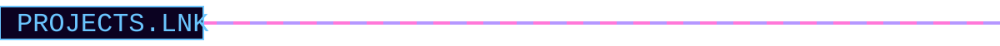

<table>
  <tr>
    <td width="50%"><a href="https://traffic-twin-iota.vercel.app"></a></td>
    <td width="50%"></td>
  </tr>
  <tr>
    <td width="50%"><a href="https://github.com/zoukkis/youtube-listen-mcp"></a></td>
    <td width="50%"><a href="https://github.com/zoukkis/kukkaro"></a></td>
  </tr>
  <tr>
    <td width="50%"><a href="https://github.com/zoukkis/rns-scope"></a></td>
    <td width="50%"><a href="https://konstakportfolio.vercel.app"></a></td>
  </tr>
</table>

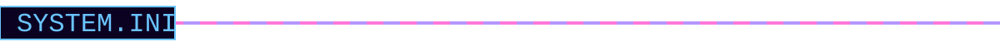

  
  
  
  
  
  
  
  
  
  
  
  

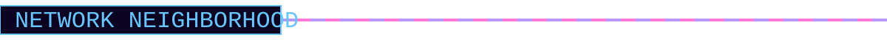

  

